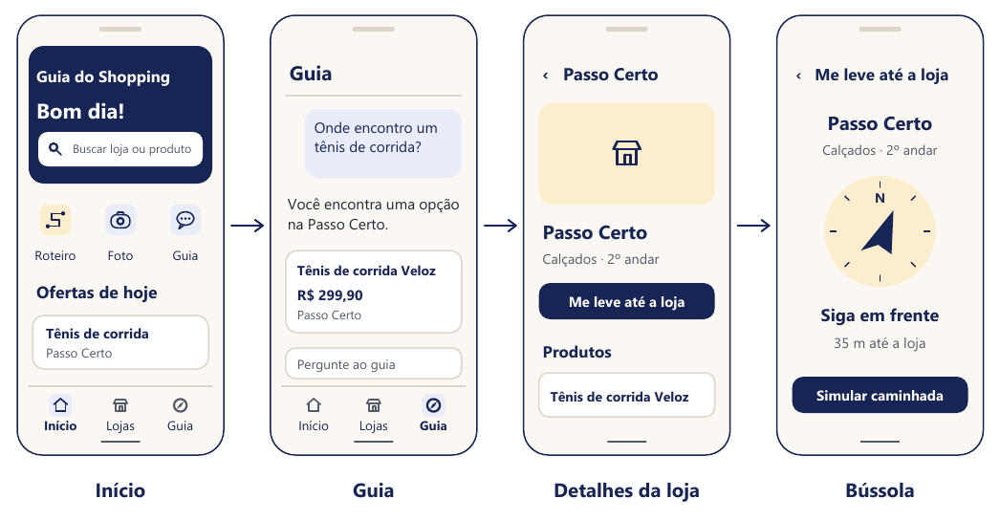

# Guia do Shopping

Projeto do Grupo 8 de Engenharia de Software. O aplicativo Android ajuda o visitante a encontrar um produto, descobrir em qual loja ele está no catálogo e seguir até lá com uma bússola.

## Planejamento técnico inicial

**[📄 Abrir o PDF do Grupo 8 no GitHub](output/pdf/Planejamento_grupo_8.pdf)**

O PDF da primeira entrega reúne a proposta, os esboços das telas, as tecnologias, a arquitetura e a prática sorteada do grupo, **Consumo de API**.

[](output/pdf/Planejamento_grupo_8.pdf)

## Da busca até a loja

1. Em **Início** ou **Lojas**, o visitante pesquisa pelo nome da loja ou do produto e consulta o catálogo e as ofertas.
2. No **Guia**, pode perguntar “Onde encontro um tênis de corrida?” ou usar uma foto para procurar algo parecido. Se quiser passar por várias lojas, pode pedir um roteiro com estimativas de tempo e custo.
3. Em **Detalhes da loja**, vê o andar e os produtos. O botão **Me leve até a loja** abre a bússola, que mostra a direção e a distância e avisa ao chegar.

**A compra é combinada com o vendedor.** Preços e ofertas ajudam na escolha. Quando a loja tem WhatsApp cadastrado, **Falar com atendente** abre a conversa fora do aplicativo. O shopping e o catálogo são fictícios, e a caminhada pode ser simulada para a demonstração.

O app oferece suporte a leitor de tela, letras grandes, modo escuro e redução de movimento.

## Arquitetura e tecnologias

| Tecnologia | Papel no projeto |
|---|---|
| Flutter e Dart | Telas Android, navegação e comunicação com a API |
| Laravel 12 e PHP | API REST e página inicial do projeto em Blade |
| MySQL | Catálogo de lojas, produtos e promoções |
| DeepSeek | Interpretação de perguntas e sugestões de roteiro com dados do catálogo |
| Google ML Kit | Reconhecimento de rótulos em fotos no próprio aparelho |
| Geolocator, Flutter Compass e Flutter TTS | Localização, direção e instruções por voz |

## Consumo de API

O Flutter faz requisições HTTPS e recebe respostas em JSON. O Laravel valida as entradas, consulta o catálogo e chama o DeepSeek quando o visitante faz uma pergunta ou pede um roteiro. Na busca por foto, o app envia os rótulos identificados pelo ML Kit e mantém a imagem no aparelho.

A API oficial usa o endereço `https://hackarun8.safra.dev/api/v1`.

| Endpoint | Uso no aplicativo |
|---|---|
| `GET /lojas` | Lista lojas e aceita filtros de busca e categoria (`q` e `category`) |
| `GET /lojas/{id}` | Carrega a ficha da loja com produtos e promoções |
| `GET /promocoes` | Carrega as ofertas da tela inicial |
| `POST /chat` | Envia perguntas ou rótulos da foto e recebe a resposta do Guia |
| `POST /roteiro` | Solicita paradas com estimativas de tempo e custo |

## Estrutura

| Pasta | Conteúdo |
|---|---|
| `backend-app/` | API em Laravel 12 (catálogo, guia, roteiro) e a página inicial do projeto |
| `shop_app/` | Aplicativo em Flutter |

## Como rodar o backend

Requer PHP 8.2 ou mais novo, Composer e MySQL.

```bash
cd backend-app
composer install
cp .env.example .env
php artisan key:generate
```

No `.env`, configure o banco (`DB_*`) e a chave do modelo de linguagem (`DEEPSEEK_API_KEY`). Depois:

```bash
php artisan migrate
php artisan db:seed --class=StoreSeeder
php artisan serve
```

Testes: `php artisan test`.

## Como rodar o aplicativo

Requer Flutter 3.24.

```bash
cd shop_app
flutter pub get
flutter run --dart-define=API_URL=http://SEU_IP:8000/api/v1
```

Sem o `--dart-define`, o app usa o endereço definido em `lib/config.dart`.

Testes: `flutter test`.

## Créditos

As fotos do catálogo vêm do [Pexels](https://www.pexels.com); os autores estão em `backend-app/public/images/catalog/credits.json`.
