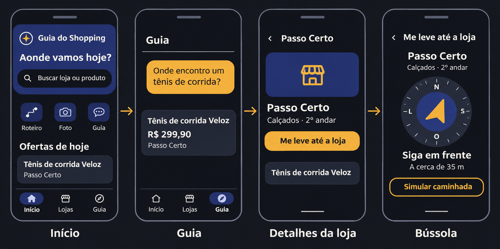
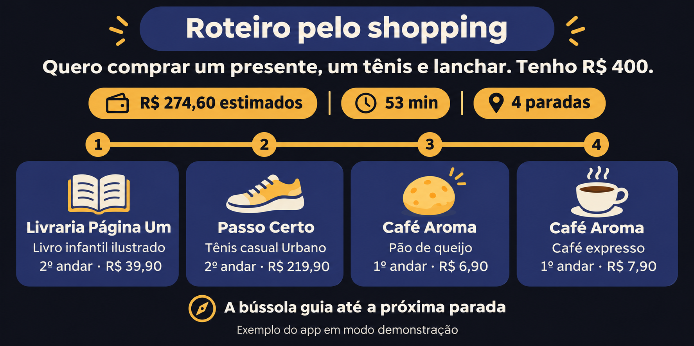
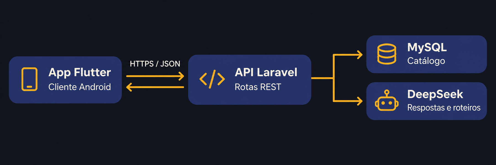

# Guia do Shopping

**Grupo 8 · Engenharia de Software**

**Tema 03 — Descoberta de produtos, lojas e promoções**

Imagine chegar ao shopping para comprar um tênis de corrida sem saber quais lojas vendem esse tipo de produto, em qual andar ficam ou onde há uma oferta. O **Guia do Shopping** reúne essas informações em um app Android e ajuda o visitante a seguir até a loja escolhida.

**[Baixar APK assinado para Android](https://github.com/rafaelbittencourt3/hackarun_grupo8/releases/download/v1.0.0/guia-do-shopping.apk)** (v1.0.0, 41,6 MB) · **[Ver o PDF do planejamento técnico](output/pdf/Planejamento_grupo_8.pdf)**

## Como funciona na prática

1. **O visitante diz o que procura.** Pode pesquisar pelo nome, perguntar ao Guia “Onde encontro um tênis de corrida?” ou usar uma foto para buscar produtos parecidos.
2. **O app indica opções do catálogo.** No exemplo da demonstração, o Guia pode sugerir um tênis da loja Passo Certo. O visitante abre a ficha para ver o andar, os produtos e as ofertas cadastradas.
3. **O visitante segue até a loja.** Ao tocar em **Me leve até a loja**, a bússola mostra a direção e a distância estimada. O app também dá instruções por voz e avisa ao chegar.

**A compra é combinada com o vendedor.** Quando a loja tem WhatsApp cadastrado, o botão **Falar com atendente** abre a conversa fora do aplicativo.



## O diferencial do Guia do Shopping

O diferencial está em **ligar a descoberta do produto à orientação dentro do shopping**. Da resposta do Guia, o visitante pode abrir a ficha da loja e iniciar a bússola. A mesma busca serve para decidir o que procurar e saber para onde ir.

- **Busca por foto.** Quando a pessoa viu um produto e não sabe o nome, o celular identifica características da imagem e o Guia procura opções parecidas no catálogo.
- **Roteiro para várias paradas.** O Guia sugere uma sequência de paradas com estimativas de tempo e custo. A bússola orienta o visitante até cada destino.

Na demonstração, o visitante pediu um presente, um tênis e um lanche com até **R$ 400**. O app sugeriu quatro paradas em **53 minutos**, com custo estimado de **R$ 274,60**. O pão de queijo e o café expresso aparecem como duas paradas no Café Aroma.



## Como experimentar

Abra o APK no Android para instalar. Se o sistema pedir, autorize a instalação pela origem usada para baixar o arquivo.

Para experimentar a navegação, abra a ficha de uma loja, toque em **Me leve até a loja** e escolha **Simular caminhada**. O shopping, as lojas e os preços são fictícios. O app oferece suporte a leitor de tela, letras grandes, modo escuro e redução de movimento.

## Arquitetura e tecnologias

| Tecnologia | Papel no projeto |
|---|---|
| Flutter e Dart | Telas Android, navegação e comunicação com a API |
| Laravel 12 e PHP | API REST e página inicial do projeto em Blade |
| MySQL | Catálogo de lojas, produtos e promoções |
| DeepSeek | Interpretação de perguntas e sugestões de roteiro com dados do catálogo |
| Google ML Kit | Reconhecimento de rótulos em fotos no próprio aparelho |
| Geolocator, Flutter Compass e Flutter TTS | Localização, direção e instruções por voz |

## Consumo de API

**Consumo de API** foi a prática técnica sorteada para o Grupo 8.



O Flutter faz requisições HTTPS e recebe respostas em JSON. O Laravel valida as entradas, consulta o catálogo e chama o DeepSeek quando o visitante faz uma pergunta ou pede um roteiro. Na busca por foto, o app envia os rótulos identificados pelo ML Kit e mantém a imagem no aparelho.

A API oficial usa o endereço `https://hackarun8.safra.dev/api/v1`.

| Endpoint | Uso no aplicativo |
|---|---|
| `GET /lojas` | Lista lojas e aceita filtros de busca e categoria (`q` e `category`) |
| `GET /lojas/{id}` | Carrega a ficha da loja com produtos e promoções |
| `GET /promocoes` | Carrega as ofertas da tela inicial |
| `POST /chat` | Envia perguntas ou rótulos da foto e recebe a resposta do Guia |
| `POST /roteiro` | Solicita paradas com estimativas de tempo e custo |

## Estrutura

| Pasta | Conteúdo |
|---|---|
| `backend-app/` | API em Laravel 12 (catálogo, guia, roteiro) e a página inicial do projeto |
| `shop_app/` | Aplicativo em Flutter |

## Como rodar o backend

Requer PHP 8.2 ou mais novo, Composer e MySQL.

```bash
cd backend-app
composer install
cp .env.example .env
php artisan key:generate
```

No `.env`, configure o banco (`DB_*`) e a chave do modelo de linguagem (`DEEPSEEK_API_KEY`). Depois:

```bash
php artisan migrate
php artisan db:seed --class=StoreSeeder
php artisan serve
```

Testes: `php artisan test`.

## Como rodar o aplicativo

Requer Flutter 3.24.

```bash
cd shop_app
flutter pub get
flutter run --dart-define=API_URL=http://SEU_IP:8000/api/v1
```

Sem o `--dart-define`, o app usa o endereço definido em `lib/config.dart`.

Testes: `flutter test`.

## Créditos

As fotos do catálogo vêm do [Pexels](https://www.pexels.com); os autores estão em `backend-app/public/images/catalog/credits.json`.
